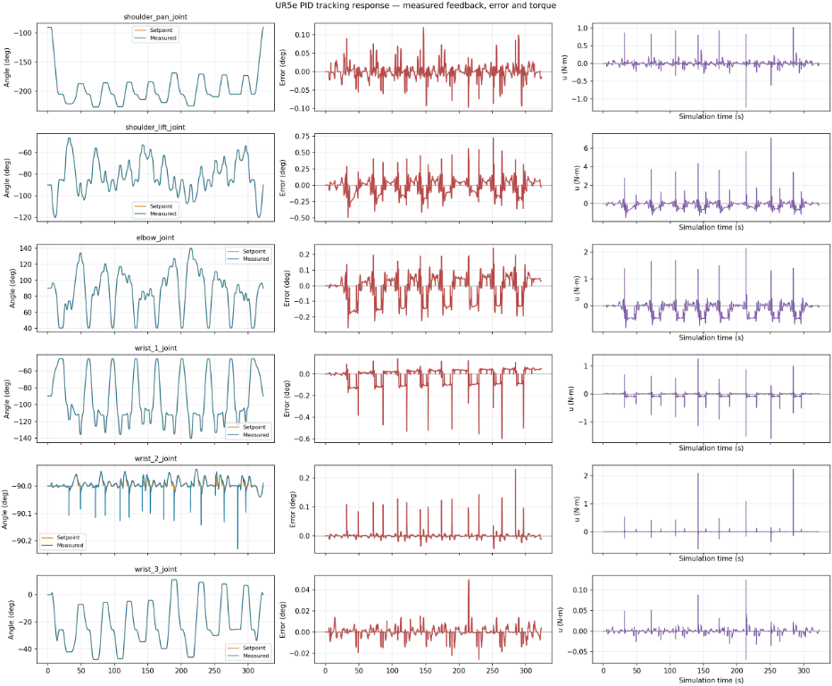

# UR5e Pick and Place — MuJoCo + ROS 2

Mô phỏng robot **UR5e + Robotiq**, gắn camera **RealSense D435i RGB-D** ở cổ tay,
tự phát hiện hộp bằng **YOLO11n**, gắp và đặt vào khay bằng **MoveIt 2**.
Sáu khớp được điều khiển bằng **effort PID ở 100 Hz** qua `ros2_control`.

- Camera xác định vị trí 3D từ RGB, depth và TF; chế độ vision không đọc vị trí hộp từ MuJoCo.
- Robot giữ hướng kẹp xuống, kiểm tra va chạm và xác nhận kết quả bằng camera sau mỗi lần đặt.
- Khay có **8 ô**; chương trình dừng khi khay đầy hoặc không có đường đi hợp lệ.
- Có đồ thị góc đặt/góc thực, sai số, mô-men điều khiển và bài thử đáp ứng bước PID.

## Cài đặt và build

Môi trường đã kiểm chứng: **Ubuntu 22.04, ROS 2 Humble, Python 3.10**, desktop có giao diện đồ họa.
Cần cài ROS 2 Humble, `rosdep`, `colcon` và `python3-venv` trước.

```bash
git clone https://github.com/DSieu2004/ur5e_mujoco_pick_place.git ur5e_pick_place_ws
cd ur5e_pick_place_ws
source /opt/ros/humble/setup.bash
rosdep install --from-paths src --ignore-src -r -y
CMAKE_BUILD_PARALLEL_LEVEL=2 colcon build --symlink-install \
  --packages-up-to ur5e_mujoco_sim --allow-overriding mujoco_ros2_control \
  --cmake-args -DCMAKE_BUILD_TYPE=RelWithDebInfo
source install/setup.bash

python3 -m venv --system-site-packages .venv-vision
.venv-vision/bin/python -m pip install -r requirements-vision.txt
```

Build cả hai package bằng `--packages-up-to` để sử dụng driver MuJoCo đã sửa lỗi
shutdown trong workspace. Lần cấu hình đầu có thể tải dependency từ Internet.
Trọng số YOLO đã được cung cấp trong [box_detector.pt](src/ur5e_mujoco_sim/models/box_detector.pt).

## Chạy tự động bằng camera

Từ thư mục workspace:

```bash
source /opt/ros/humble/setup.bash
source install/setup.bash
ros2 launch ur5e_mujoco_sim vision_pick_place.launch.py
```

Lệnh này mở mô phỏng, camera preview, bộ điều khiển, MoveIt và tác vụ gắp–đặt.
Scene mặc định có **7 hộp**. Đóng cửa sổ MuJoCo hoặc nhấn `Ctrl+C` để dừng.

| Launch argument | Chức năng |
|---|---|
| `preview:=false` | Tắt cửa sổ camera preview |
| `run_task:=false` | Chỉ mở mô phỏng và camera |
| `device:=0` | Chạy YOLO trên CUDA GPU; mặc định là CPU |
| `confidence:=0.40` | Ngưỡng phát hiện YOLO |
| `scene:=/absolute/path/scene.xml` | Dùng scene khác |
| `vision_python:=/absolute/path/python` | Dùng Python environment khác |

Để thử 8 hộp, tạo scene rồi chạy trong một phiên mô phỏng mới:

```bash
.venv-vision/bin/python src/ur5e_mujoco_sim/tools/generate_box_scene.py \
  --count 8 --seed 23 --output vision_data/scenes/eight_boxes.xml
ros2 launch ur5e_mujoco_sim vision_pick_place.launch.py \
  scene:="$PWD/vision_data/scenes/eight_boxes.xml"
```

## Đáp ứng PID

Dừng phiên mô phỏng đang chạy rồi mở bài thử riêng:

```bash
ros2 launch ur5e_mujoco_sim pid_response.launch.py
```

Bài thử lần lượt áp bước **0.05 rad** lên sáu khớp và trở về home.
Đồ thị hiển thị đáp ứng, sai số và mô-men `u`; kết quả có **Rise Time**,
**Overshoot**, **Settling Time** và **Steady-State Error**.
Dữ liệu lấy từ bộ điều khiển thực trong mô phỏng; mô hình Python PID chỉ dùng tham chiếu offline.

Đáp ứng bám quỹ đạo PID trong quá trình gắp–đặt: cột trái là góc đặt và góc thực,
cột giữa là sai số, cột phải là mô-men điều khiển `u` của sáu khớp.



CSV, đồ thị PNG/SVG, kết quả kiểm tra và dữ liệu camera được lưu riêng theo từng lần
chạy trong `trajectory_runs/`. Thư mục này cùng build output, Python environment
và dữ liệu huấn luyện được bỏ qua bởi Git.

## Chế độ cũ

Chế độ này gắp năm hộp bằng vị trí đọc trực tiếp từ mô phỏng. Mở hai terminal
đã source ROS và workspace:

```bash
# Terminal 1: chọn một trong hai launch
ros2 launch ur5e_mujoco_sim mujoco.launch.xml
# Hoặc điều khiển effort PID:
# ros2 launch ur5e_mujoco_sim mujoco_pid.launch.xml

# Terminal 2
ros2 run ur5e_mujoco_sim pick_place
```

## Kiểm chứng và phạm vi

Các lần kiểm chứng ngày 27/10/2026 đạt **7/7 và 8/8 hộp**, hoàn thành bài thử PID
sáu khớp và **12/12 kiểm thử shutdown**. Bộ kiểm tra hồi quy có 8 bài:

```bash
.venv-vision/bin/python -m pytest src/ur5e_mujoco_sim/test/test_project_regressions.py -q
```

Project hiện được kiểm chứng với **hộp lập phương 6 cm, một lớp, trong vùng bàn quy định**.
Camera và depth là mô phỏng; triển khai trên robot thật cần hiệu chuẩn và kiểm chứng thêm.
Mô hình YOLO được fine-tune bằng ảnh tổng hợp, chưa được kiểm chứng với ảnh camera thật.

## Mã nguồn và upstream

- [ur5e_mujoco_sim](src/ur5e_mujoco_sim/): scene, cấu hình, vision, quy trình gắp–đặt và PID.
- [mujoco_ros2_control](src/mujoco_ros2_control/UPSTREAM.md): driver upstream 0.1.2 cùng bản sửa vòng đời luồng/plugin khi shutdown.
- [MoveGroup](src/ur5e_mujoco_sim/native/UPSTREAM.md): executable dựa trên MoveIt 2 Humble, sửa thứ tự giải phóng plugin.
- [D435i](src/ur5e_mujoco_sim/models/realsense_d435i/UPSTREAM.md): nguồn mesh và giấy phép của mô hình camera.

Các thông báo bản quyền và giấy phép upstream được giữ trong những thư mục tương ứng.
